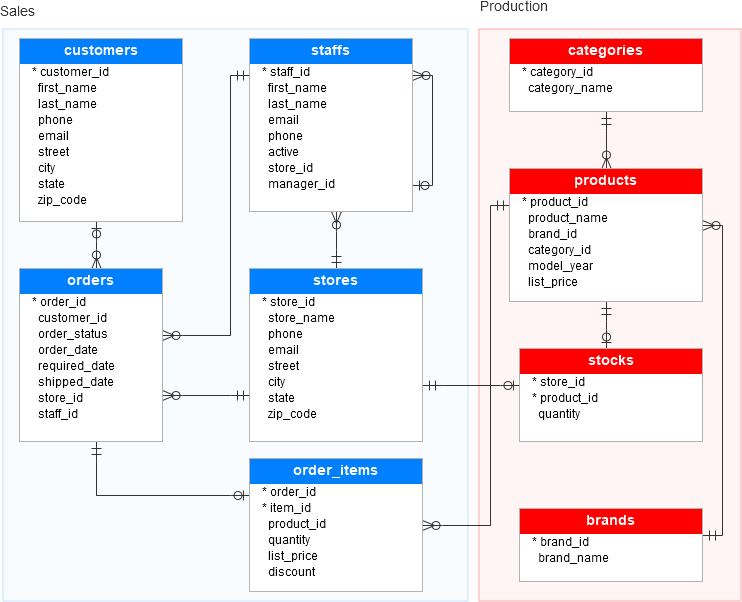

# Semester Project Ekren – NoSQL Database Queries
<hr>

## Project Goal

The goal of this project is to transform a relational SQL dataset from Kaggle into a document-based NoSQL data model using MongoDB.
The data is not imported 1:1 as raw CSV files. Instead, a Python script transforms the relational structure and stores the resulting documents in MongoDB.

<hr>

## Dataset Used

**Dataset:** Bike Store Relational Database / SQL Sample Database  
**Source:** Kaggle  
**Kaggle Link:** TODO: Insert link to the used Kaggle dataset

The dataset describes a bike store with customers, orders, products, brands, categories, staff members, stores, and stock information.

## Original Relational Structure

The original dataset consists of several relational tables, including:

- `customers`
- `orders`
- `order_items`
- `products`
- `categories`
- `brands`
- `stores`
- `staffs`
- `stocks`

Important relationships:

- One customer can have multiple orders.
- One order can contain multiple order items.
- One order item references one product.
- One product belongs to one category and one brand.
- One product can have stock quantities in multiple stores.

## Relational ER Diagram


<hr>

## MongoDB Data Model

For MongoDB, the relational structure is transformed into two main collections:

```text
Database: semesterproject_db2

Collections:
- orders
- products
```

### Collection `orders`

The `orders` collection is built from:

- `orders.csv`
- `order_items.csv`
- `customers.csv`
- `stores.csv`
- `staffs.csv`

Each order document contains the original order information from the `orders` table. Foreign key fields such as `customer_id`, `store_id`, and `staff_id` are not duplicated on the root level. Instead, they are moved into the embedded `customer`, `store`, and `staff` documents.

The related order items are embedded as an array. Each order item preserves the relevant columns from `order_items.csv`. The `order_id` is not duplicated inside each item because it is already represented by the parent order document. The `product_id` remains inside each item as a reference to the `products` collection.

Example structure:

```json
{
  "order_id": 1,
  "order_status": 4,
  "order_date": "2016-01-01",
  "required_date": "2016-01-03",
  "shipped_date": "2016-01-03",
  "customer": {
    "customer_id": 259,
    "first_name": "Example",
    "last_name": "Customer",
    "phone": null,
    "email": "customer@example.com",
    "street": "Example Street",
    "city": "Example City",
    "state": "NY",
    "zip_code": "12345"
  },
  "store": {
    "store_id": 1,
    "store_name": "Example Store",
    "phone": "123456789",
    "email": "store@example.com",
    "street": "Store Street",
    "city": "Store City",
    "state": "CA",
    "zip_code": "90001"
  },
  "staff": {
    "staff_id": 2,
    "first_name": "Example",
    "last_name": "Staff",
    "email": "staff@example.com",
    "phone": "123456789",
    "active": 1,
    "store_id": 1,
    "manager_id": 1
  },
  "items": [
    {
      "item_id": 1,
      "product_id": 20,
      "quantity": 1,
      "list_price": 599.99,
      "discount": 0.2
    }
  ]
}
```

The relationship between orders and products is therefore modeled as a reference:

```text
orders.items.product_id -> products.product_id
```

This avoids duplicating complete product data inside every order while still embedding the order items directly into the order document.

### Collection `products`

The `products` collection is built from:

- `products.csv`
- `brands.csv`
- `categories.csv`
- `stocks.csv`

Each product document contains the original product information from the `products` table. Foreign key fields such as `brand_id` and `category_id` are not duplicated on the root level. Instead, they are moved into the embedded `brand` and `category` documents.

Stock rows are embedded as an array. The `product_id` is not duplicated inside each stock entry because it is already represented by the parent product document.

Example structure:

```json
{
  "product_id": 1,
  "product_name": "Example Product",
  "model_year": 2016,
  "list_price": 379.99,
  "brand": {
    "brand_id": 9,
    "brand_name": "Example Brand"
  },
  "category": {
    "category_id": 6,
    "category_name": "Example Category"
  },
  "stocks": [
    {
      "store_id": 1,
      "quantity": 27
    }
  ]
}
```

### Index Strategy

Indexes were created based on the expected query patterns of the MongoDB model, not simply on every available field.

The `product_id` and `order_id` fields are indexed uniquely because they represent the original primary keys from the relational SQL model.

The selected indexes support the planned query types of the project:

- Top-N queries, such as the most expensive products
- Relationship queries, such as products of a specific brand or orders of a specific customer
- Aggregation queries, such as revenue per store, orders per customer, and sold units per product
- Queries on embedded documents and arrays, such as `customer.customer_id`, `store.store_id`, and `items.product_id`

The following index strategy is used:

- `products.product_id` as a unique index for direct product lookup
- `products.brand.brand_id` for filtering products by brand
- `products.category.category_id` for filtering products by category
- `products.list_price` for Top-N price queries


- `orders.order_id` as a unique index for direct order lookup
- `orders.customer.customer_id` for customer-based order queries
- `orders.store.store_id` for store-based aggregations
- `orders.staff.staff_id` for staff/seller-related queries
- `orders.items.product_id` for finding orders that contain a specific product

Additionally, compound indexes are used for common combined filters, such as:

- orders of a customer sorted or filtered by date
- orders of a store sorted or filtered by date
- orders by status and date

This keeps the index strategy aligned with realistic query patterns while avoiding unnecessary indexes on fields that are not used in the project queries.
## Data Transformation

The relational tables are not stored as separate 1:1 MongoDB collections.

Instead, relationships are resolved during the import process and related data is embedded into documents:

- `order_items` is embedded into `orders.items[]`.
- `customers`, `stores`, and `staffs` are embedded into `orders`.
- `brands`, `categories`, and `stocks` are embedded into `products`.

This creates a document-based MongoDB model that supports typical queries without classical SQL joins.

<hr>

## Project Structure

```text
semesterprojekt_ekren/
├── code/
│   ├── queries
│   │   ├── mongodb
│   │   │   └── queries.mongodb
│   │   │
│   │   └── sql_legacydata
│   │       ├── db_relation_setup.sql
│   │       └── db_setup.sql
│   │
│   └── scripts/
│       ├── import_data.py
│       └── requirements.txt
│
├── data/
│   └── kaggle_tables/
│       ├── brands.csv
│       ├── categories.csv
│       ├── customers.csv
│       ├── order_items.csv
│       ├── orders.csv
│       ├── products.csv
│       ├── stocks.csv
│       ├── staffs.csv
│       └── stores.csv
│
├── docs/
│   └── er-diagram_sql.png
│
├── README.md
└── .gitignore
```

<hr>

## Requirements

- Python 3
- Local MongoDB installation
- Python packages from `requirements.txt`

MongoDB runs locally at:

```text
mongodb://localhost:27017
```

## Installation

Go to the scripts folder:

```bash
cd code/scripts
```

Create and activate a virtual environment:

```bash
python3 -m venv .venv
source .venv/bin/activate
```

Install the required packages:

```bash
pip install -r requirements.txt
```

## Run the Import

```bash
python import_data.py
```

The script reads the CSV files from `data/kaggle_tables/`, transforms the relational data, and imports the resulting documents into MongoDB.

<hr>

## Queries

The MongoDB queries will be stored later in:

`code/queries/queries.mongodb`

Planned queries:

### Top-N Queries

1. Show the top 10 most expensive products
2. Show the top 5 customers with the most orders
3. Show the top 10 most sold products
4. Show the top 5 staff members/sellers by handled orders or revenue

### Relationship Queries

1. Show all orders of a specific customer
2. Show all products of a specific brand
3. Show all orders where a specific product was sold

### Aggregation and Summary Queries

1. Calculate the revenue made by each store
2. Calculate the average order value per store
3. Count the amount of orders per customer
4. Calculate the sold units per product

The queries can be executed directly in MongoDB Compass or `mongosh`.
